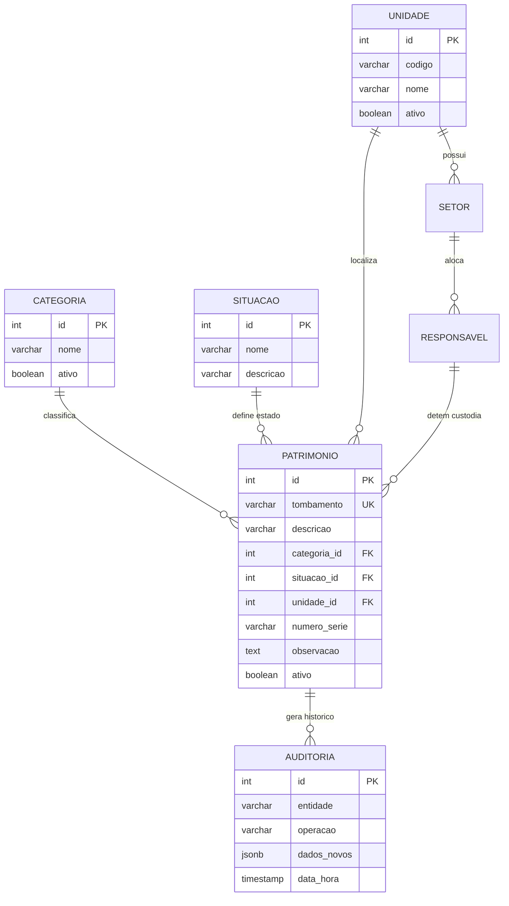

# Sistema de Gestão de Bens Patrimoniais (e-Patrimônio SMS Diadema)

> **Projeto Integrador em Computação II (PJI240)**  
> **Universidade Virtual do Estado de São Paulo — UNIVESP**  
> **Parceria Institucional:** Secretaria Municipal da Saúde (SMS) de Diadema  

---

## 📋 Visão Geral

O **e-Patrimônio SMS Diadema** é uma aplicação corporativa multiplataforma (Web e Mobile) desenvolvida para modernizar, agilizar e conferir total transparência à gestão de materiais permanentes e bens patrimoniais da rede pública de saúde de Diadema.

A plataforma resolve o gargalo histórico de controle manual e disperso de equipamentos, oferecendo:
- **Tombamento e Inventário Digital:** Cadastro detalhado de equipamentos hospitalares, informática, mobiliário e climatização.
- **Custódia Nominal Rastreável:** Atribuição formal de responsabilidade a servidores públicos municipais com matrícula e cargo.
- **Movimentações e Transferências:** Controle de remessas e remanejamentos entre Unidades Básicas de Saúde (UBSs), Almoxarifado Central, Farmácia Central e Sede da SMS.
- **Trilha Imutável de Auditoria:** Registro histórico detalhado de todas as operações realizadas (criação, alteração, custódia e baixa).
- **Indicadores Contábeis em Tempo Real:** Dashboard executivo com cálculo de patrimônio líquido alocado e taxas de operacionalidade.

---

## 🎯 Atendimento aos Requisitos do Projeto Integrador

| Requisito Acadêmico | Implementação na Aplicação | Tecnologias Utilizadas |
| :--- | :--- | :--- |
| **Framework Web** | Aplicação responsiva universal executando tanto em navegadores quanto em dispositivos móveis | **Expo SDK 57 / React 19 / React Native Web** |
| **Banco de Dados** | Banco relacional na nuvem com modelo normalizado, chaves estrangeiras e persistência ACID | **PostgreSQL (Supabase Cloud)** |
| **Script Web (JS/TS)** | Lógica de negócio client-side, formatações monetárias, buscas dinâmicas e persistência assíncrona | **TypeScript / JavaScript Moderno (ESNext)** |
| **Computação em Nuvem** | Aplicação frontend, backend de autenticação e banco de dados distribuídos na nuvem | **Google Cloud Run, Vercel e Supabase** |
| **Uso de APIs** | Integração com OAuth 2.0 Google, API RESTful de tokens e API REST/PostgREST do Supabase | **Axios, Google Identity Services, Supabase JS** |
| **Acessibilidade (a11y)** | Conformidade WCAG AA, suporte a leitores de tela (TalkBack/VoiceOver) e contraste semântico | **Accessible, AccessibilityRole, Labels e Hints** |
| **Controle de Versão** | Versionamento com Git, branches de desenvolvimento e histórico rastreável | **Git & GitHub** |
| **Testes Automatizados** | Suíte de testes unitários e de integração validando regras de negócio e camada de dados | **Jest & Jest-Expo (16 testes aprovados)** |
| **Análise de Dados** | Painel de controle com KPIs, taxa de conservação e distribuição percentual por categoria | **Dashboard Analítico com Agregações Reativas** |

---

## 🏗️ Arquitetura e Estrutura do Banco de Dados

A aplicação adota a estratégia **Offline-First / Cache-First com Sincronização Assíncrona em Nuvem**, garantindo zero latência na interface do usuário e tolerância a falhas temporárias de rede.

```
                      +-----------------------------+
                      |   Cliente (Web / Mobile)    |
                      |   React 19 + Expo Router    |
                      +--------------+--------------+
                                     |
             +-----------------------+-----------------------+
             |                                               |
             v                                               v
+----------------------------+                 +----------------------------+
|  Armazenamento Local       |                 |  Camada em Nuvem           |
|  (Cache em Memória / Web)  | <=============> |  - API Cloud Run (Auth)    |
|  Operações Síncronas (0ms) |   Sincronismo   |  - Supabase PostgreSQL     |
+----------------------------+    Assíncrono   +----------------------------+
```

### Modelo Entidade-Relacionamento (DER)



---

## 📱 Módulos e Funcionalidades

### 1. Visão Geral (Dashboard)
- **Indicadores Principais (KPIs):** Total de bens patrimoniais cadastrados, valor contábil acumulado do lote, quantidade de bens ativos, em manutenção e baixados.
- **Distribuição por Categoria:** Gráfico percentual interativo exibindo a proporção de equipamentos de saúde, informática, mobiliário e climatização.
- **Linha do Tempo de Atividades:** Lista em tempo real com as últimas ações de cadastro, edição e custódia.

### 2. Consulta de Materiais (Inventário)
- **Busca Rápida e Filtragem:** Pesquisa textual instantânea por nome do equipamento, número de tombamento ou servidor responsável.
- **Filtros por Categoria:** Segmentação rápida por tipo de material com contadores dinâmicos.
- **Modos de Operação (RBAC):**
  - **Administrador:** Acesso total à inclusão, edição, alteração de custódia e baixa patrimonial.
  - **Consulta (Operador):** Modo protegido de leitura para consulta de bens e localização nas unidades.

### 3. Detalhes e Ficha Patrimonial
- Exibição de especificações completas: marca, modelo, número de série e data/valor de aquisição.
- Atribuição nominal de servidor público com matrícula e cargo através de seletor pesquisável.
- Edição de estado de conservação (*Ativo*, *Em Manutenção* ou *Baixado*).

### 4. Relatórios e Trilha de Auditoria
- Registro cronológico completo de operações com data, hora, autor e descrição da ação.
- Filtro por tipo de evento (*Cadastro*, *Alteração*, *Atribuição*, *Exclusão*, *Transferência*).
- Exportação e impressão de relatórios consolidados do inventário para prestação de contas.

### 5. Movimentações de Carga
- Gestão de remanejamento de materiais permanentes entre unidades da Secretaria.
- Acompanhamento do fluxo de status: *Aprovado*, *Aguardando Aprovação* e *Recusado*.

---

## ♿ Acessibilidade (WCAG AA)

O sistema foi desenhado visando inclusão digital plena para servidores com deficiência visual ou motora:
- **Semântica:** Elementos interativos declarados com `accessible={true}` e `accessibilityRole` correspondente (`button`, `header`, `search`, etc.).
- **Leitores de Tela:** Rotulagem com `accessibilityLabel` e `accessibilityHint` em todos os botões, ícones, modais e formulários.
- **Estados Reativos:** Propriedade `accessibilityState={{ selected, disabled }}` utilizada em abas e menus laterais.
- **Contraste:** Combinações cromáticas em conformidade com a taxa mínima de 4.5:1 recomendada pela WCAG.

---

## 🧪 Testes Automatizados

O projeto conta com suíte automatizada de testes desenvolvida com **Jest** e **jest-expo**, garantindo a estabilidade das regras de negócio e da sincronização de dados:

```bash
npm test
```

### Cobertura dos Testes:
1. **`servidoresService.test.ts` (6 testes):**
   - Listagem integral de servidores públicos da Secretaria Municipal de Saúde.
   - Busca por nome, matrícula, cargo e setor.
   - Resiliência contra termos vazios ou buscas sem correspondência.
2. **`patrimonioService.test.ts` (10 testes):**
   - Listagem e busca de patrimônios por identificador único.
   - Cálculo contábil das métricas e valor patrimonial líquido.
   - Cadastro de novo bem e geração automática de registro na trilha de auditoria.
   - Atualização cadastral e alteração de estado de conservação.
   - Atribuição nominal de custódia a servidor municipal.
   - Baixa e exclusão com segurança patrimonial.
   - Sincronização bidirecional com o banco de dados PostgreSQL na nuvem.

---

## 🚀 Instalação e Execução

### Pré-requisitos
- **Node.js** (versão 20 ou superior recomendada)
- Gerenciador de pacotes **npm**

### Passo a Passo

1. **Clonar o Repositório:**
   ```bash
   git clone https://github.com/rsilvasousa1212/Projeto-Integrador-PJI240-Grupo-04.git
   cd gestao-patrimonio
   ```

2. **Instalar Dependências:**
   ```bash
   npm install
   ```

3. **Configuração de Variáveis de Ambiente:**
   Copie o arquivo de modelo `.env.example` para `.env` e preencha com as credenciais do seu ambiente:
   ```bash
   cp .env.example .env
   ```
   Variáveis requeridas:
   - `EXPO_PUBLIC_API_URL`: URL base da API de autenticação no Cloud Run.
   - `EXPO_PUBLIC_SUPABASE_URL`: Endpoint da instância do Supabase.
   - `EXPO_PUBLIC_SUPABASE_ANON_KEY`: Chave pública/anônima do Supabase.
   - `EXPO_PUBLIC_GOOGLE_WEB_CLIENT_ID`: ID do cliente OAuth Google (Web).
   - `EXPO_PUBLIC_GOOGLE_ANDROID_CLIENT_ID`: ID do cliente OAuth Google (Android).

4. **Executar a Aplicação:**
   ```bash
   # Inicia o servidor Expo
   npm start
   
   # Para abrir diretamente no navegador
   npx expo start --web
   ```

5. **Comandos de Qualidade e Verificação:**
   ```bash
   # Execução dos testes automatizados
   npm test

   # Checagem estática de tipos TypeScript
   npx tsc --noEmit

   # Análise de padrões de código (Lint)
   npx expo lint
   ```

---

## 📁 Estrutura de Diretórios

```
gestao-patrimonio/
├── .env.example                      # Modelo de variáveis de ambiente
├── .env                              # Variáveis de ambiente locais (ignorado no Git)
├── package.json                      # Dependências e scripts do projeto
├── tsconfig.json                     # Configurações do compilador TypeScript
├── README.md                         # Documentação técnica do projeto
└── src/
    ├── __tests__/                    # Suíte de testes automatizados (Jest)
    │   ├── patrimonioService.test.ts
    │   └── servidoresService.test.ts
    ├── app/                          # Rotas e telas da aplicação (Expo Router)
    │   ├── _layout.tsx               # Configuração do navegador raiz
    │   ├── index.tsx                 # Tela de Login (Google OAuth & Demonstração)
    │   ├── dashboard.tsx             # Painel com KPIs e distribuição gráfica
    │   ├── materiais.tsx             # Catálogo de bens e inventário
    │   ├── novo-patrimonio.tsx       # Formulário de tombamento de novos bens
    │   ├── relatorios.tsx            # Trilha de auditoria e relatórios analíticos
    │   ├── movimentacoes.tsx         # Gestão de transferências e remanejamentos
    │   └── detalhes/
    │       └── [id].tsx              # Ficha patrimonial e termo de custódia
    ├── components/                   # Componentes reutilizáveis
    │   ├── AppLayout.tsx             # Menu lateral responsivo, cabeçalho e perfil
    │   ├── ModalEditarPatrimonio.tsx # Modal de edição de informações patrimoniais
    │   └── SeletorResponsavelModal.tsx # Seletor pesquisável de servidores públicos
    └── services/                     # Camada de serviços e integração
        ├── api.ts                    # Cliente HTTP para API de autenticação
        ├── authStorage.ts            # Gerenciamento de sessão e perfil do usuário
        ├── patrimonioService.ts      # Regras de negócio, auditoria e sincronização
        ├── servidoresService.ts      # Base de dados de servidores municipais
        └── supabase.ts               # Conexão com o banco relacional PostgreSQL
```

---

## 👥 Equipe do Projeto
RENATO DA SILVA DE SOUSA


**Projeto Integrador em Computação II — UNIVESP (Turma 2026)**  
- **Polo:** Diadema  
- **Grupo:** 04  
- **Instituição Beneficiária:** Secretaria Municipal da Saúde (SMS) de Diadema  
